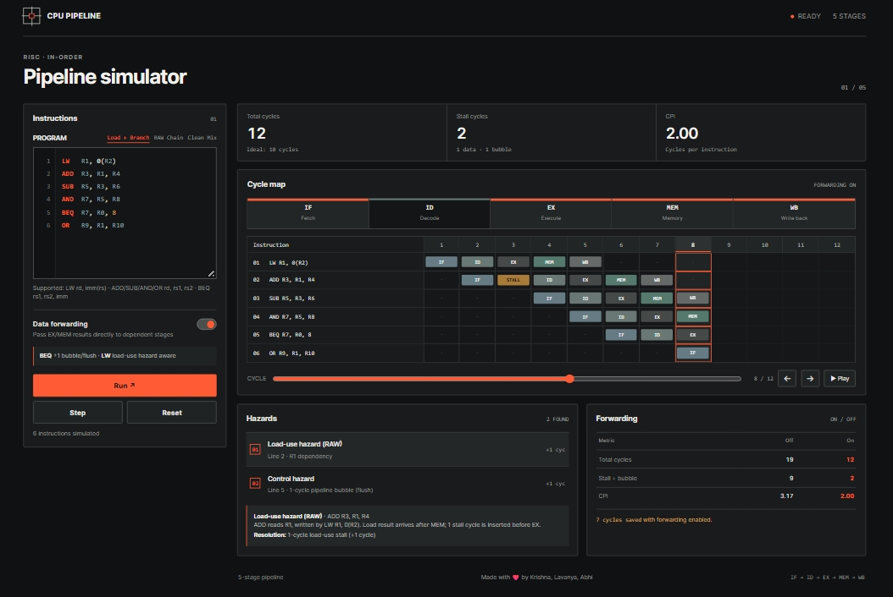
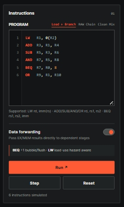
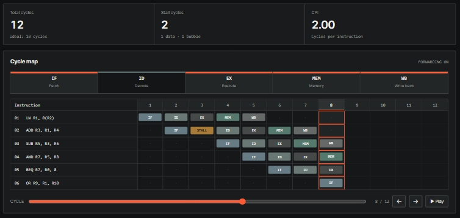
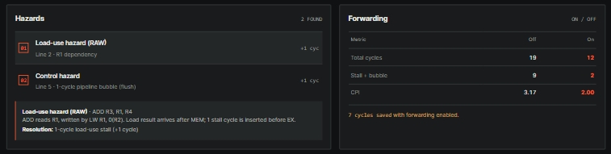

# CPU Pipeline Hazard Simulator

A simple, interactive **5-Stage CPU Pipeline Simulator** built for our **Computer Organization & Architecture (COA)** project. It shows how instructions move step by step inside a CPU, catches pipeline hazards, and compares performance when **Data Forwarding** is turned **ON** or **OFF**.


*Full simulator interface showing the assembly editor, live cycle metrics, animated cycle map, detected hazards, and forwarding comparison.*

## What Does This Project Do? (In Simple Words)

Inside a modern CPU, instructions do not wait for one instruction to completely finish before starting the next one. Instead, the CPU works like an **assembly line** with **5 stages**:

```text
+------+     +------+     +------+     +------+     +------+
|  IF  | --> |  ID  | --> |  EX  | --> | MEM  | --> |  WB  |
|Fetch |     |Decode|     |Exec  |     |Memory|     |Write |
+------+     +------+     +------+     +------+     +------+
```

1. **IF (Instruction Fetch)**: Reads the instruction from memory.
2. **ID (Instruction Decode)**: Understands the instruction and reads register values.
3. **EX (Execute)**: Performs math or logic calculations (like `ADD` or `SUB`).
4. **MEM (Memory Access)**: Reads data from memory (used by `LW`).
5. **WB (Write Back)**: Saves the final answer back into a register.

Sometimes, instructions depend on each other or a branch happens. These problems are called **Hazards**, and they slow down the pipeline by adding **Stalls** or **Bubbles**. This simulator lets you watch all of this happen cycle by cycle!

## Feature Walkthrough by Section

### 1. Assembly Instruction Editor & Controls



* **Line-Numbered Syntax Editor**: Highlights opcodes (`LW`, `ADD`, `SUB`, `AND`, `OR`, `BEQ`), registers (`R0`–`R31`), numbers/offsets, and comments (`#` or `;`).
* **3 Predefined Sample Programs**: Switch between **Load + Branch**, **RAW Chain**, and **Clean Mix** with one click.
* **Data Forwarding Switch (ON / OFF)**: Toggle forwarding ON or OFF and watch how stalls drop immediately.
* **Playback Controls**:
  * **Run**: Animates the pipeline automatically from Cycle 1 to completion.
  * **Step**: Advances **1 clock cycle** at a time.
  * **Reset**: Clears the timeline and resets all metrics.

### 2. Performance Metrics & 5-Stage Cycle Map



* **Live Performance Cards**:
  * **Total cycles**: Shows actual execution cycles (`12` in the sample run) alongside the hazard-free **Ideal** count (`10 cycles`).
  * **Stall cycles**: Breaks down data stalls and control bubbles (`1 data · 1 bubble`).
  * **CPI**: Calculates Cycles Per Instruction (`2.00`).
* **Interactive Cycle Map**:
  * Highlights active stages (`IF`, `ID`, `EX`, `MEM`, `WB`) in the top stage bar for the selected cycle (`Cycle 8 / 12` above).
  * Shows amber **`STALL`** blocks (such as `ADD R3, R1, R4` waiting 1 cycle in Cycle 3 after `LW R1, 0(R2)`) and dashed **`BUBBLE`** blocks after `BEQ`.
  * Includes a **Cycle Slider**, **`←` / `→` buttons** (plus keyboard arrow keys), and **Play / Pause**.

### 3. Hazard Detection & Forwarding Comparison



* **Hazards Panel**:
  * Lists every detected **Load-use hazard (RAW)**, **Data hazard (RAW)**, and **Control hazard**.
  * Clicking any hazard opens a plain-English explanation showing which instruction caused it, which register conflicted, and how many penalty cycles were added.
* **Forwarding ON / OFF Comparison Table**:
  * Compares **Off** vs. **On** side by side (`19` cycles vs. `12` cycles, `9` stalls vs. `2` stalls, and `3.17` CPI vs. `2.00` CPI) and displays total cycles saved (`7 cycles saved with forwarding enabled`).

## Step-by-Step User Guide

1. **Open the Simulator**: Double-click `index.html` in any web browser (Chrome, Edge, Firefox, or Safari). No installation or internet connection is required.
2. **Load or Write a Program**: Click **Load + Branch**, **RAW Chain**, or **Clean Mix**, or type your own RISC assembly instructions.
3. **Set Data Forwarding**: Turn **Data forwarding** **ON** or **OFF**.
4. **Run or Step**:
   * Press **Run** to watch the cycle-by-cycle animation.
   * Press **Step** (or drag the **CYCLE** slider / press `←` and `→`) to inspect any clock cycle manually.
5. **Analyze Results**: Click each hazard card to read its cause and check the **Forwarding** table to see the speedup.

## Supported Instructions

You can use registers `R0` through `R31` (`R0` is hardwired to `0`, so writing to `R0` never causes a hazard). Comments start with `#` or `;`.

| Instruction | Format | Example | What It Does |
| :--- | :--- | :--- | :--- |
| **LW** | `LW rd, imm(rs)` | `LW R1, 0(R2)` | Loads a word from memory address `R2 + 0` into `R1` |
| **ADD** | `ADD rd, rs1, rs2` | `ADD R3, R1, R4` | Computes `R1 + R4` and stores the result in `R3` |
| **SUB** | `SUB rd, rs1, rs2` | `SUB R5, R3, R6` | Computes `R3 - R6` and stores the result in `R5` |
| **AND** | `AND rd, rs1, rs2` | `AND R7, R5, R8` | Computes bitwise `R5 AND R8` and stores it in `R7` |
| **OR** | `OR rd, rs1, rs2` | `OR R9, R1, R10` | Computes bitwise `R1 OR R10` and stores it in `R9` |
| **BEQ** | `BEQ rs1, rs2, imm` | `BEQ R7, R0, 8` | Branch instruction (inserts 1 fetch `BUBBLE` in this model) |

## How the Simulator Calculates Cycles (COA Logic)

1. **Ideal Cycles**: For $N$ instructions with no hazards, pipeline execution takes $N + 4$ cycles.
2. **CPI (Cycles Per Instruction)**:
   $$\text{CPI} = \frac{\text{Total Cycles}}{\text{Number of Instructions}}$$
3. **With Forwarding ON**:
   * **ALU** $\rightarrow$ **ALU**: $0$ stalls (result is forwarded directly).
   * **LW** $\rightarrow$ **Next Instruction**: $1$ `STALL` cycle (load-use hazard).
4. **With Forwarding OFF**:
   * Dependent instructions stall up to $\max(0, 3 - \text{distance})$ cycles until the producer instruction writes back its result.
5. **Control Hazard (`BEQ`)**:
   * Inserts $1$ `BUBBLE` cycle after `EX` to model a 1-cycle branch fetch flush.

## Project Files

```text
CPU-Pipeline-Simulator/
├── index.html                        # Main webpage structure, stage strip, cycle table, and cards
├── style.css                         # Dark theme, orange highlights, responsive layout, and animations
├── script.js                         # Instruction parser, hazard detector, simulator engine, and controls
├── assets/
│   ├── dashboard-full.png            # Full simulator screenshot
│   ├── section-editor.png            # Instruction editor & controls screenshot
│   ├── section-cycle-map.png         # Metrics & 5-stage cycle map screenshot
│   └── section-hazards-forwarding.png # Hazards & forwarding comparison screenshot
└── README.md                         # Project guide and documentation
```

## Authors

Made with 💌 by **Krishna, Lavanya, Abhi**